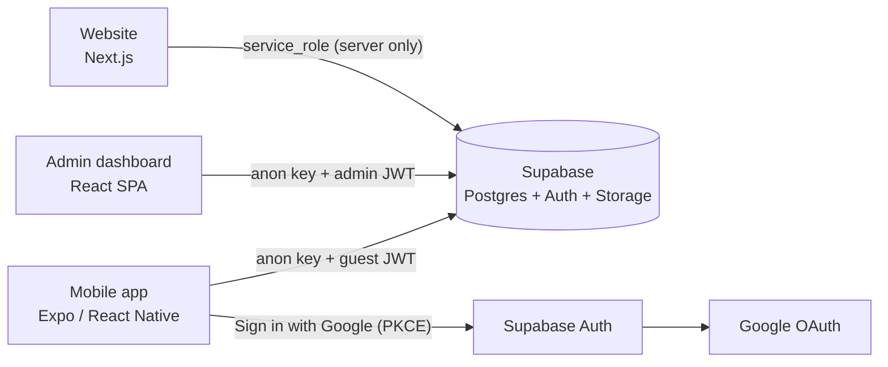

# The Wild Oasis — Mobile

Guest app for **The Wild Oasis**, a boutique cabin hotel in the Dolomites. Guests browse cabins,
sign in with Google, book a stay on an availability calendar, and manage their reservations
and profile.

Built with **Expo (React Native) + TypeScript** on the same **Supabase** database as the
[website](https://the-wild-oasis-website-udemy.vercel.app) (Next.js) and the hotel's
[admin dashboard](https://the-wild-oasis-udemy.vercel.app) (React SPA), so a booking made in the
app shows up in both.

A portfolio project: the website and dashboard come from a course; this app, its security
model and the database hardening are my own work.

## Features

- **Cabins**: list with photos, prices and discounts, capacity filter, pull-to-refresh, detail screen
- **Google sign-in** (Supabase Auth, OAuth with PKCE); the guest profile is created on first sign-in
- **Booking**: range calendar that blocks booked nights, guest count within the cabin's and
  hotel's limits, notes, price summary; prices are computed by the database, not the app
- **Reservations**: upcoming and past stays, edit guests and notes, cancel upcoming stays
  (optimistic update with rollback)
- **Profile**: nationality picker with flags, national ID validation
- Haptic feedback, loading/empty/error states; one codebase for iOS, Android and web

## Architecture



- No custom API: the app talks to Supabase directly with the **public anon key**. Everything it
  may read or write is decided by **Postgres Row Level Security** and a few
  `security definer` functions, so the key inside the app grants nothing on its own.
- Reads go through **TanStack Query** (caching, retries, refetch); writes are mutations that
  invalidate or optimistically update the cache.

## Security

The shared database came from a course where every signed-in user could read and change every
table. Since the app lets anyone sign in with Google, that would have exposed every guest's
data to every guest. Before writing any sign-in code I:

1. **Audited** the policies, grants and auth settings
   ([`docs/sql/00-inspect-security.sql`](docs/sql/00-inspect-security.sql)), and checked how the
   admin dashboard uses the database so the fix wouldn't break it.
2. **Split admins from guests** with a server-side `app_metadata.role` claim and replaced the
   allow-all policies: guests see only their own profile and bookings, everyone can read cabins,
   only admins can change cabins/settings or upload images
   ([`01-rls-admins-and-guests.sql`](docs/sql/01-rls-admins-and-guests.sql)).
3. **Moved booking writes into database functions**
   ([`02-booking-rpcs.sql`](docs/sql/02-booking-rpcs.sql)): `create_booking` checks dates,
   overlaps (with a per-cabin lock against double booking), guest limits, and computes the price
   itself; `update_booking` only touches your own upcoming bookings; `get_booked_dates` exposes
   availability without guest data.
4. **Verified** each step with scripts that impersonate an anonymous visitor, a guest and an
   admin inside a rolled-back transaction ([`01-rls-check.sql`](docs/sql/01-rls-check.sql),
   [`02-booking-rpcs-check.sql`](docs/sql/02-booking-rpcs-check.sql)), then again through the
   REST API as a real Google user.

The full audit, findings and decisions are in [docs/PLAN.md](docs/PLAN.md).

## Tech

| | |
|---|---|
| App | Expo SDK 58, Expo Router (file-based routes, typed), React Native 0.88, React 19, TypeScript, React Compiler |
| Data | `@supabase/supabase-js`, TanStack Query, session stored with `expo-sqlite` |
| Auth | Supabase Auth + Google, `expo-web-browser` auth session, PKCE code exchange |
| UI | `StyleSheet` with the website's color tokens, Josefin Sans, `expo-image`, `expo-symbols` (SF Symbols / Material Symbols), `expo-haptics`, a hand-written range calendar (`date-fns`) |
| Delivery | EAS Build (Android APK), Expo Go for development |

## Run it

**Android:** install the APK from the latest
[EAS build](https://expo.dev/accounts/deividas-butkus/projects/the-wild-oasis-mobile/builds).

**From source:**

```bash
nvm use                       # Node 24 (.nvmrc)
npm install
cp .env.example .env.local    # Supabase URL + publishable (anon) key
npx expo start                # scan the QR code with Expo Go, or press w for web
```

## Project layout

```
src/app/            routes (Expo Router): (tabs)/ cabins, reservations, account;
                    cabins/[id]/ detail + reserve; reservations/[id] edit; auth/callback
src/components/     UI building blocks (cabin card, range calendar, forms, country picker…)
src/lib/            Supabase client, auth, data hooks (cabins, bookings, guest), haptics
docs/PLAN.md        plan, decisions, security audit and test log
docs/sql/           database migrations and verification scripts
assets/icon-source/ app icon as SVG (rendered to the PNGs in assets/images)
```
